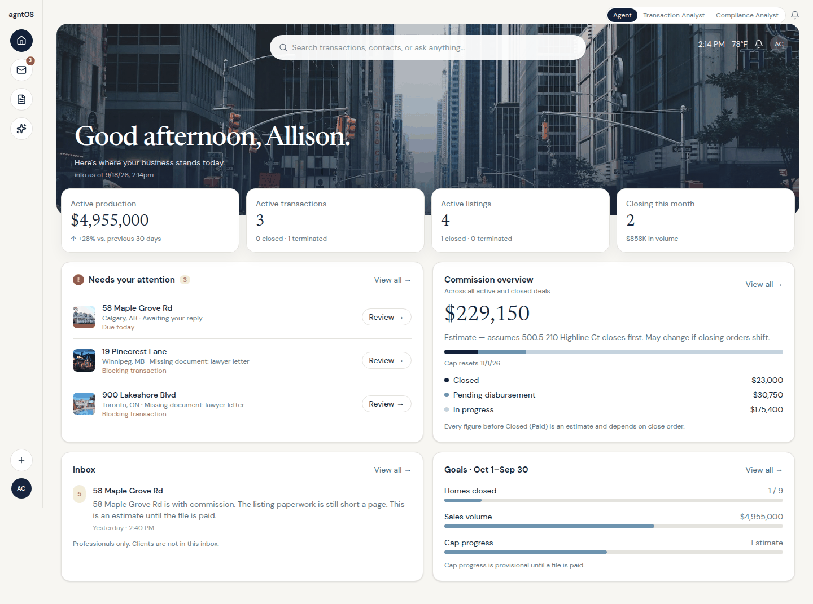
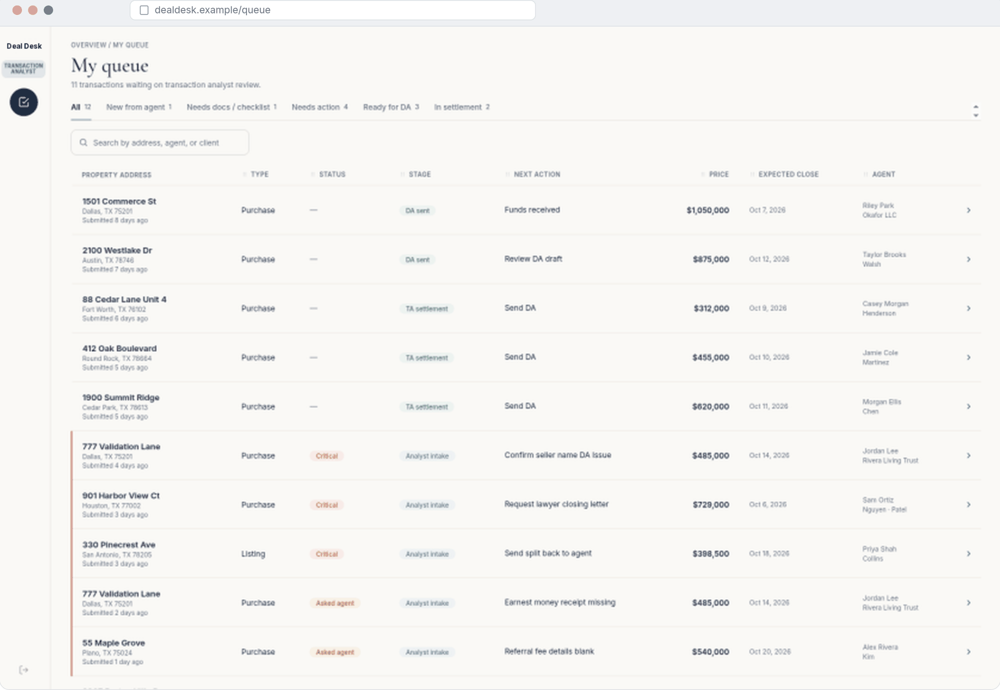
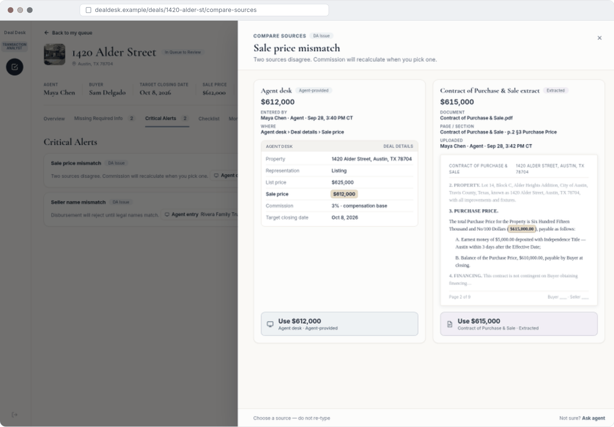
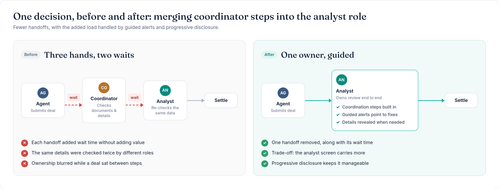

# AgentOS: one desk for a real-estate deal, from submitted to paid

**[Read the case study →](https://suvarnamyneni-project.github.io/agntos-case-study/)**

Suvarna Myneni · UX case study

One deal, one record, one desk. AI does the checking, and people make the decisions.

AgentOS (agntOS) Deal Desk is an AI-native transaction desk for the US and Canada. It is designed and prototyped, with a demo build. It is not in production yet, so there are no live metrics. Screens use synthetic demo data. Gold highlights on the case study are notes still open.

## Role

UX lead for the staff and settlement experience. I extended an analyst prototype a teammate had started, and I own the agntOS design system. [TO CONFIRM: exact title on this program]

I led the staff side: the work a Transaction Analyst does to move a deal from the queue to disbursed, including exceptions, the compliance hand-off, and the agent's view of the same timeline. Agents work in the agent platform. Staff work in Deal Desk and Task Center.

Duration: 2025–2026. Research and prototyping ran through Aug–Oct 2026. [TO CONFIRM: start month]

## The problem

To close one deal, agents and staff moved between about 11 tools. Fee details sat in free-text notes and got re-keyed. Staff spent most of their effort checking numbers rather than deciding, and agents could not see where their deal stood.

How might a Transaction Analyst take one deal from submission to the accounting hand-off, with every number traceable and every error visible?

## How it worked before

One deal, from submitted to paid, crossed five handoff stages: agent, coordinator, compliance, analyst, operations. Tool names below are generalized.

1. The agent submitted the deal and typed splits and referrals as free-text notes.
2. The agent filled fields that did not apply, and retyped MLS data.
3. A coordinator chased missing documents with hand-built emails.
4. Compliance checked signatures and sent files back. Review status did not always sync.
5. The agent fixed and re-uploaded, with no ping when a document was rejected.
6. An analyst re-keyed fee details out of the notes.
7. The analyst compared dates and amounts by hand, and typed check details.
8. "Where is my deal?" went from support to the analyst, production support and accounting.
9. Operations and accounting set up fees, posted to the ledger and matched a nightly bank file. In Canada, shared spreadsheets.
10. Posting errors after "settled" were often found through agent reports and fixed by hand.

The pain in that path:

- About 11 separate tools to take one deal from submitted to paid, by my journey-mapping count
- Five handoff stages per deal, and a payment question that passed through four roles
- Most effort went into checking, not deciding
- Status was invisible, so agents called support
- Exceptions were the real workflow: mismatches, failed postings and changed close dates
- Alerts had lost their meaning. The demo group named 80 critical alerts that blocked automatic disbursement authorizations
- The US and Canada work differently, so a label swap would have been wrong
- Analysts still left the desk to get a check copy and read notes

[TO CONFIRM: an average time per deal or screen count for this flow, if anyone measured one. Without it, the before state stays qualitative.]

## The solution

Role-based queues, one deal spine from submitted to disbursed, AI document review that flags differences for a person to resolve, validation gates that stay locked until the checks pass, and one design system for agents and staff.

- The queue is sorted oldest first. A row shows status, stage and the next action.
- Coordinator steps merge into the analyst role. The coordinator becomes a contact on the file.
- Send and Settle stay locked until the checks pass. Every disabled control says why.
- On a mismatch, the analyst picks the value. The choice is visible, reversible and timestamped.
- Money is labeled as an estimate until settlement, because commission and cap depend on close order.
- A disbursed file is read-only. A correction is a new record, with a reason.

## AI approach

AI belongs where the input is unstructured: documents. Rules belong where the answer must be exact: fees, balances and dates. A person decides wherever sources disagree or money moves.

| Task | Approach |
| --- | --- |
| Classify documents and extract dates, amounts and check details | AI |
| Signatures and required documents | AI, with a hard block. Re-upload or override is a recorded human action |
| Fees, balances and dates | Rules. The gates fail closed |
| Which value wins on a mismatch | Human. No agreed rule exists, so a person chooses |
| Overrides and corrections | Human, with a reason |

Each extracted value cites the document, page and section. The AI reports three outcomes — Passed, Suggestions, Couldn't review — kept separate from Approved and Rejected. [TO CONFIRM: show a numeric confidence score?] If document AI is down, the analyst can enter values by hand. Demo data is synthetic. [TO CONFIRM: PII rules for AI processing]

## Key screens

[](https://suvarnamyneni-project.github.io/agntos-case-study/#summary)

Agent home. Attention comes first, and commission is an estimate until the file is paid.

[](https://suvarnamyneni-project.github.io/agntos-case-study/#summary)

Analyst queue, oldest first. Status, stage and the next action are on the row.

[](https://suvarnamyneni-project.github.io/agntos-case-study/#summary)

Review and choose. Two sources disagree. The analyst picks a value instead of retyping it.

[](https://suvarnamyneni-project.github.io/agntos-case-study/#before-after)

One decision, before and after: coordinator steps merge into the analyst role.

## Expected outcomes

These are targets to track after launch. Nothing here has been measured in production. Numeric targets are still open. [TO CONFIRM]

| Expected outcome | Metric to track after launch |
| --- | --- |
| Fewer screens per deal | Screens per settlement versus the legacy flow. Target [TO CONFIRM] |
| Faster settlement | Median time from submitted to settled. Target [TO CONFIRM] |
| Fewer "where is my deal?" contacts | Support contacts per 100 deals. Target [TO CONFIRM] |
| Trusted AI review | Correction rate on extracted fields, and the share of files that still need a full human review |
| Exceptions handled earlier | Posting failures caught by support before an agent reports them |

Research coverage so far, not impact: 19 personas, 14 journeys, 57 settlement steps and 40 flows mapped, plus a prototype check of 7 journeys covered, 6 partial and 1 missing.

## Publish this site

The case study is static. `index.html` is at the repository root, with images in `assets/`. There is no build step. An empty `.nojekyll` file is included so GitHub Pages serves the files as they are.

To preview locally:

```bash
python3 -m http.server 8000
```

Then open http://localhost:8000.

To turn on the live link, the repository owner needs to:

1. Open this repository on GitHub.
2. Go to **Settings → Pages**.
3. Under **Build and deployment**, set **Source** to **Deploy from a branch**.
4. Set the branch to **main** and the folder to **/ (root)**.
5. Save.

GitHub will publish https://suvarnamyneni-project.github.io/agntos-case-study/ from `index.html`.
